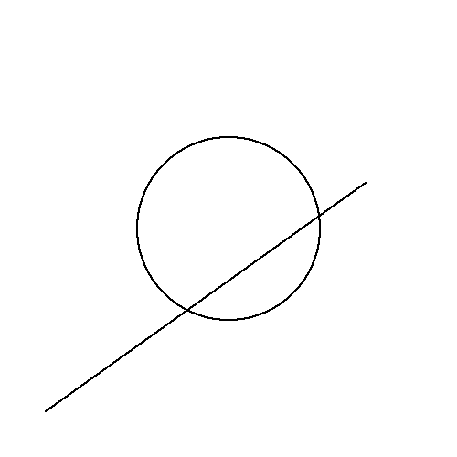

# CGVR Lab — Experiment 1

## Bresenham's Line Drawing Algorithm & Bresenham's (Midpoint) Circle Algorithm

This experiment implements two classic rasterization algorithms using Python OpenGL (PyOpenGL + GLUT):

1. **Bresenham's Line Algorithm** — draws a line from `(50, 50)` to `(400, 300)` using only integer arithmetic.
2. **Bresenham's (Midpoint) Circle Algorithm** — draws a circle centered at `(250, 250)` with radius `100` using 8-way symmetry.

The rendered frame is **automatically saved as a PNG image** on startup, which is pushed to this repository so the output can be viewed directly on GitHub.

## Output



## Requirements

```bash
pip install -r requirements.txt
```

## How to Run

```bash
python Experiment_1.py
```

The OpenGL window opens with the rendered line and circle, and the PNG snapshot is saved to:

```
output/exp1_bresenham_line_circle.png
```

### Keyboard Controls

| Key | Action |
|-----|--------|
| `s` | Save a PNG snapshot of the current frame |
| `q` / `Esc` | Quit |

### Custom Output Path

```bash
python Experiment_1.py --output custom/screenshot.png
```

## Files

| File | Description |
|------|-------------|
| `Experiment_1.py` | Main program: Bresenham line + circle, PNG export |
| `requirements.txt` | Python dependencies |
| `output/exp1_bresenham_line_circle.png` | Rendered output image (pushed to GitHub) |