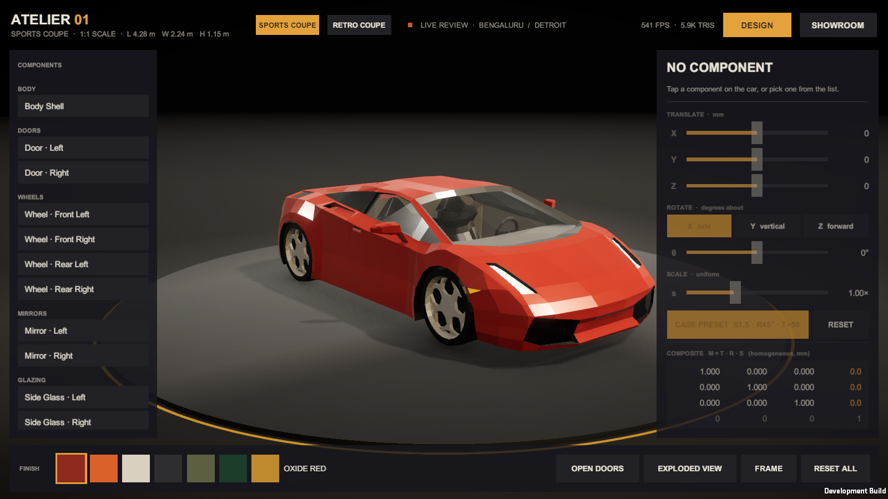
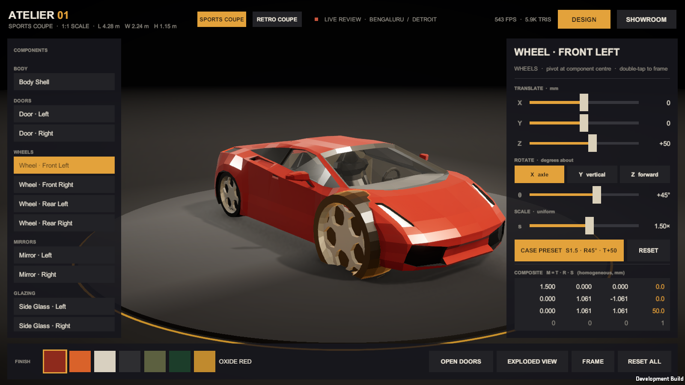
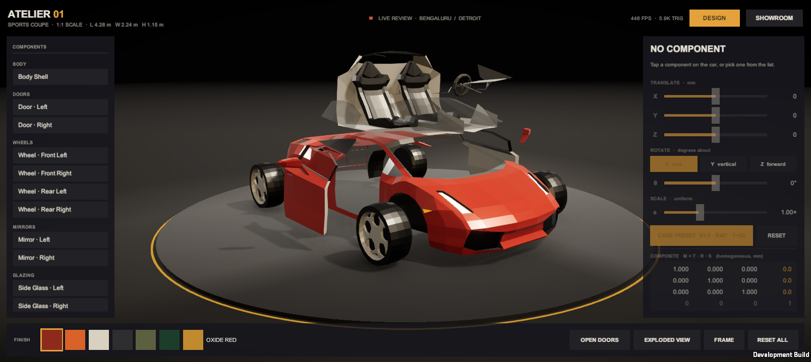
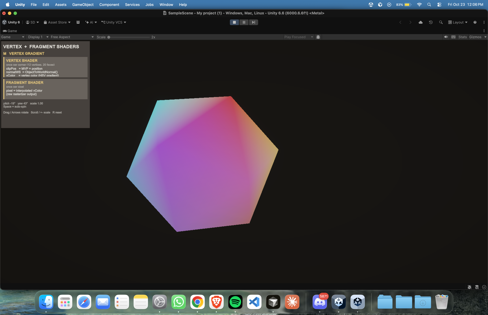
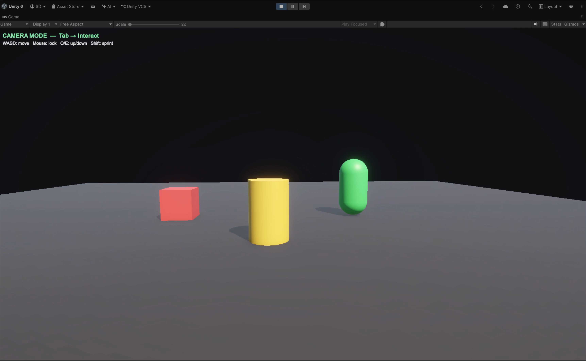
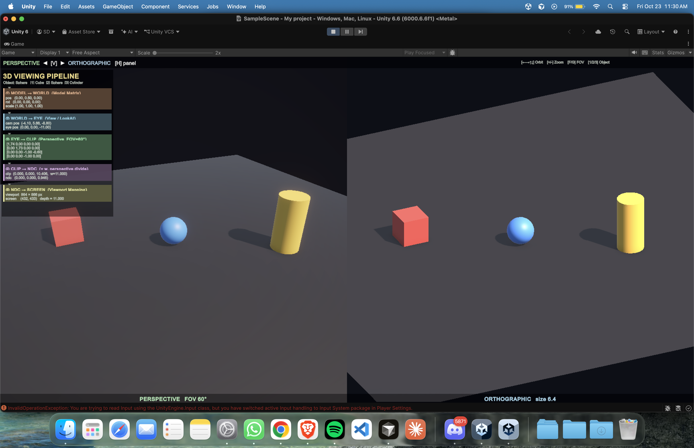

# Computer Graphics and Virtual Reality — Lab Record

| | |
|---|---|
| **Subject** | Computer Graphics and Virtual Reality |
| **Student** | Desu Sree Vardhan |
| **USN** | 1RUA24CSE7004 |
| **Stack** | Python · PyOpenGL · GLSL · Unity 6 · C# · URP |

---

## Labs

| # | Experiment | Tech | Concepts |
|---|-----------|------|---------|
| [1](CGVR_LAB1/) | DDA and Bresenham's Line Drawing | Python · PyOpenGL | Rasterisation, incremental line algorithms |
| [2](CGVR_LAB2/) | Midpoint Circle Drawing | Python · PyOpenGL | Midpoint decision parameter, 8-way symmetry |
| [3](CGVR_LAB3/) | 2D Transformations — Homogeneous Coordinates | Python · PyOpenGL | Translation, rotation, scaling via 3×3 matrices |
| [4](CGVR_LAB4/) | Composite 2D Transformations | Python · PyOpenGL | Matrix concatenation, pivot-point transforms |
| [5](CGVR_LAB5/) | Cohen–Sutherland Line Clipping | Python · PyOpenGL | Outcodes, Clip–Sutherland reject/trivial-accept |
| [6](CGVR_LAB6/) | Z-Buffer Hidden Surface Removal | Python · PyOpenGL | Depth buffer, painter's algorithm comparison |
| [7](CGVR_LAB7/) | Phong Illumination Model | Python · PyOpenGL · GLSL | Ambient/diffuse/specular, per-fragment shading |
| [8](CGVR_LAB8/) | Vertex and Fragment Shaders | Unity 6 · URP · HLSL | MVP transform, barycentric edge detection, N·L lighting |
| [9](CGVR_LAB9/) | Simple Interactive 3D Scene | Unity 6 · URP · C# | Runtime scene building, CharacterController, interact mode |
| [10](CGVR_LAB10/) | 3D Viewing Pipeline | Unity 6 · URP · C# | Model→World→Eye→Clip→NDC→Screen, perspective vs orthographic |

---

## Case Study 2 · Atelier Car Designer

> **CS4104 · Case Study 2 — Industrial Design & Architecture**

A fully interactive **1:1 scale VR car designer** built in Unity 6 (URP) for the Bengaluru–Detroit collaborative prototyping scenario. Two car models (Sports Coupe, Retro Coupe) are loaded at runtime; the designer can select any component, apply a live composite **T·R·S transform** (translate mm, rotate °, scale ×), switch paint finishes, open doors, and trigger an exploded view — all while a live 4×4 matrix panel shows the exact homogeneous transform.

| Topic | Implementation |
|---|---|
| **Geometric Modeling** | B-Rep NURBS → tessellated FBX import; CSG-style procedural `DiscMesh`/`RingMesh` |
| **Composite T·R·S** | `CarPart.ApplyPose()` — pivot-centred `p′ = c + t + R·(s·(p−c))`, mm-integer precision |
| **Clipping & HSR** | Sutherland–Hodgman frustum cull · Z-buffer (32-bit, reverse-Z) · back-face cull · Umbra PVS |
| **Rendering** | URP Forward+, MSAA 4×, Single-Pass Instanced stereo, chromatic-key paint recolouring |
| **Platforms** | macOS Standalone · Android · WebGL |





📄 **[Case Study Report (Word)](CaseStudy2_CarDesigner/CaseStudy2_Report.docx)** · **[How to run](CaseStudy2_CarDesigner/HOW_TO_RUN.md)**

### Run it yourself (Unity 6)

1. Install **Unity 6000.6.6f1** from Unity Hub (any nearby Unity 6 release also works).
2. Hub → **Add project from disk** → select the `CaseStudy2_CarDesigner` folder.
3. Open `Assets/CarDesigner/Scenes/CarStudio` and press **Play**.

First import takes a few minutes while Unity generates `Library/`. Full controls and troubleshooting: [HOW_TO_RUN.md](CaseStudy2_CarDesigner/HOW_TO_RUN.md).

---

## Lab Highlights

### Labs 1 – 7 · Python / PyOpenGL
Implemented in pure Python using PyOpenGL and GLUT. Each lab runs as a standalone script with live keyboard controls and an on-screen algorithm panel.

### Lab 8 · Vertex and Fragment Shaders
A procedurally generated icosahedron rendered by a custom URP HLSL shader. The vertex shader transforms each of the 12 corners and passes a position-derived HSV color; the fragment shader cycles through three modes — raw vertex gradient, barycentric wireframe overlay, and per-pixel N·L + specular lighting.



### Lab 9 · Interactive 3D Scene
A Unity scene built entirely at runtime from a single C# script attached to the Main Camera. A `CharacterController` provides gravity and collision so the camera cannot clip through the floor or objects. Tab switches between first-person camera mode and an interact mode where objects can be selected, translated, rotated, and scaled.



### Lab 10 · 3D Viewing Pipeline
Split-screen Unity scene with a perspective camera on the left and an orthographic camera on the right — both driven by the same orbit. A live HUD panel tracks every stage of the GPU pipeline (model matrix → view matrix → projection matrix → NDC → screen coordinates) for a selected object, updating in real time as the camera moves.



---

## Running the Python labs

```bash
cd CGVR_LAB<N>
pip install -r requirements.txt   # PyOpenGL + PyOpenGL_accelerate
python <script>.py
```

## Running Case Study 2

See [CaseStudy2_CarDesigner/HOW_TO_RUN.md](CaseStudy2_CarDesigner/HOW_TO_RUN.md). Short version: add `CaseStudy2_CarDesigner` in Unity Hub, open `CarStudio`, press Play.

## Running the Unity labs (8, 9, 10)

1. Open the project folder in **Unity Hub** (Unity 6, Universal 3D template).
2. Attach the lab script to **Main Camera**.
3. **Edit → Project Settings → Player → Active Input Handling → Both**.
4. Press **▶ Play**.

Each script builds its entire scene at runtime — no prefabs or manual scene setup required.
